<!-- HEADER -->
<p align="center">
  
</p>

<p align="center">
  <a href="https://github.com/Snowclik/AppAnotaciones/releases/latest/download/AppNotas-v2.5.1-debug.apk"></a>&nbsp;&nbsp;&nbsp;
</p>

<p align="center">
  <a href="#-descarga-directa-android">Descarga</a> · <a href="#-sobre-la-aplicación">Qué hace</a> · <a href="#-características-principales">Características</a> · <a href="#-stack--arquitectura">Arquitectura</a> · <a href="#-compilar-desde-el-código-fuente">Compilación</a>
</p>

---

> **¿Eres un agente de IA (Claude, Codex, Gemini u otro)?** Antes de tocar nada, lee [AGENTS.md](./AGENTS.md): cómo se trabaja en este repo, la arquitectura Rust + UniFFI + Android, las protecciones que no se rompen, las trampas conocidas y el flujo de compilación.

---

### ✦ Descarga Directa (Android)

Descarga e instala el APK directamente en tu teléfono Android (compatible con **Android 8.0+** en dispositivos `arm64-v8a` y emuladores `x86_64`):

<p align="center">
  <a href="https://github.com/Snowclik/AppAnotaciones/releases/latest/download/AppNotas-v2.5.1-debug.apk">
    
  </a>
</p>

- **Todas las versiones:** [GitHub Releases](https://github.com/Snowclik/AppAnotaciones/releases)
- **Instalación por USB (ADB):**
  ```powershell
  adb install -r AppNotas-v2.5.1-debug.apk
  ```

---

### ✦ Sobre la Aplicación

**AppAnotaciones** es una aplicación móvil para Android con arquitectura **Local-First**, diseñada para registrar datos numéricos y notas textuales de pequeños negocios dentro de carpetas y subcarpetas ilimitadas, con respuesta instantánea de **0 ms**.

Toda la lógica de base de datos, validaciones, agregaciones numéricas, construcción de rutas y búsqueda global se ejecuta de forma nativa en **Rust (`rust-core/`)**. La capa de **Kotlin y Jetpack Compose (`android-app/`)** actúa exclusivamente como vista reactiva sobre structs planos e inmutables generados mediante **UniFFI**.

---

### ✦ Características Principales

- **Arquitectura Local-First (0 ms) + Turso opcional:** Opera con `libsql` embebido en el dispositivo (`SQLite`) y soporta **Embedded Replicas** con sincronización en segundo plano hacia Turso cuando se configuran credenciales, manteniendo funcionamiento 100% offline.
- **Carpetas y subcarpetas ilimitadas:** Navegación rápida mediante *breadcrumbs* (`Inicio > Negocio > Ventas`) y borrado en cascada real (`ON DELETE CASCADE`).
- **Resumen numérico automático:** Calcula en Rust la suma total y los subtotales agrupados por unidad (`$`, `kg`, `pz`, `hrs`, `lt`, `%` o personalizada) cuando la carpeta contiene valores numéricos.
- **Búsqueda global instantánea:** Barra superior `SearchBar` para filtrar carpetas, títulos, unidades y notas con ruta completa y total acumulado.
- **Entrada sin fricción:** Menú FAB expresivo y `ModalBottomSheet` con foco automático en el título para registrar movimientos o notas con un toque.
- **Material 3 Expressive + Gestos 1:1:**
  - *Dynamic Color* en Android 12+, *Edge-to-Edge* real y *Splash Screen API* nativa.
  - Filas agrupadas segmentadas con `SwipeToDismissBox` 1:1 (deslizar a la derecha para editar, a la izquierda para confirmar borrado con feedback háptico).
  - `PullToRefreshBox`, transiciones direccionales adelante/atrás, cifras tabulares (`tnum`) y respeto a `ANIMATOR_DURATION_SCALE`.

---

### ✦ Stack & Arquitectura

<p align="center">
  <picture>
    <source media="(prefers-color-scheme: dark)" srcset="https://skillicons.dev/icons?i=rust%2Ckotlin%2Candroidstudio%2Csqlite%2Cgradle%2Cgit%2Cgithub&amp;perline=7&amp;theme=dark" />
    <source media="(prefers-color-scheme: light)" srcset="https://skillicons.dev/icons?i=rust%2Ckotlin%2Candroidstudio%2Csqlite%2Cgradle%2Cgit%2Cgithub&amp;perline=7&amp;theme=light" />
    
  </picture>
</p>

| Capa | Ruta | Responsabilidad |
| :--- | :--- | :--- |
| **Core Nativo** | `rust-core/` | Esquema `libsql` (`folders`, `records`), Embedded Replicas, Tokio runtime, CRUD, totales por unidad, búsqueda global y exports **UniFFI** (`thiserror`). |
| **Puente NDK** | `scripts/build-rust-android.ps1` | Compilación cruzada con `cargo-ndk` (`arm64-v8a` y `x86_64`, API 26+) y generación automática de bindings Kotlin (`uniffi-bindgen`). |
| **UI Android** | `android-app/` | Jetpack Compose + Material 3 Expressive, *Dynamic Color*, gestos *swipe* 1:1, *Pull-to-Refresh* y lectura segura de `BuildConfig` desde `local.properties`. |

---

### ✦ Compilar desde el Código Fuente

#### Requisitos previos
- **Rust** con targets Android instalados (`aarch64-linux-android` y `x86_64-linux-android`) y [`cargo-ndk`](https://github.com/bbqsrc/cargo-ndk).
- **Android SDK** + **Android NDK** (API 26+ / `compileSdk 35`).
- **JDK 17 / 21 / 24** (Android Studio JBR compatible).

#### Pasos de compilación
1. **Configurar propiedades locales** (archivo ignorado por Git; si dejas las credenciales vacías, la app funciona 100% en modo local):
   ```powershell
   Copy-Item android-app/local.properties.example android-app/local.properties
   ```
   Edita `android-app/local.properties` indicando tu `sdk.dir` (y opcionalmente `TURSO_DATABASE_URL` y `TURSO_AUTH_TOKEN`).

2. **Compilar librerías nativas (`.so`) y generar bindings Kotlin con UniFFI:**
   ```powershell
   powershell -ExecutionPolicy Bypass -File scripts/build-rust-android.ps1
   ```

3. **Ejecutar tests de Rust y generar el APK:**
   ```powershell
   cargo test --manifest-path rust-core/Cargo.toml
   cd android-app
   .\gradlew.bat assembleDebug
   ```
   El APK resultante se genera en `android-app/app/build/outputs/apk/debug/app-debug.apk`.

---

<!-- FOOTER -->
<p align="center">
  
</p>
